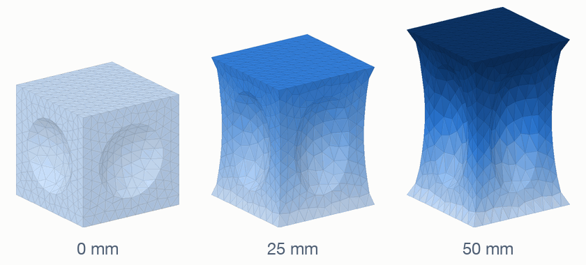

# Awesome Computational Mechanics and AI

**549 entries for computational mechanics, from finite elements and soft tissue to AI-coupled CFD, LLM agents, solvers and validation**, with licenses, commercial-software requirements and known usage restrictions noted.

 
Soft-tissue cube simulated with <a href="https://github.com/x9m/JANP-DJTLED-GPU">JANP-DJTLED</a> (<a href="assets/LICENSE">MIT</a>)

## Start here

| I want to | Start with | Then browse |
| --- | --- | --- |
| Learn finite elements | [Imperial College course](https://github.com/finite-element/finite-element-course) | [Teaching and compact codes](topics/finite-and-boundary-element-methods.md#teaching-and-compact-codes) |
| Write a solver in Python | [scikit-fem](https://github.com/kinnala/scikit-fem) | [General-purpose frameworks](topics/finite-and-boundary-element-methods.md#general-purpose-frameworks) |
| Simulate soft tissue | [FEBio](https://github.com/febiosoftware/FEBio) | [Real-time finite elements](topics/soft-body-real-time-and-differentiable-simulation.md#real-time-finite-elements) |
| Model contact | [IPC Toolkit](https://github.com/ipc-sim/ipc-toolkit) | [Contact mechanics](topics/contact-mechanics.md) |
| Learn material laws from data | [EUCLID](https://github.com/EUCLID-code/EUCLID-hyperelasticity) | [Unsupervised model discovery](topics/constitutive-modeling-and-material-identification.md#unsupervised-model-discovery) |
| Try virtual elements | [50 lines of VEM](https://github.com/oliversutton/50LinesOfVEM) | [Virtual element method](topics/virtual-element-method.md) |
| Solve large systems | [PETSc](https://gitlab.com/petsc/petsc) | [Linear, eigenvalue and nonlinear solvers](topics/linear-eigenvalue-and-nonlinear-solvers.md) |
| Combine AI with CFD | [TU Dresden course](https://github.com/AndreWeiner/ml-cfd-lecture) | [Hybrid AI and computational fluid dynamics](topics/hybrid-ai-and-computational-fluid-dynamics.md) |
| Verify and validate a model | [SimEval](https://github.com/OSEL-DAM/SimEval) | [Verification, validation and uncertainty](topics/verification-validation-and-uncertainty.md) |

## Contents

1. [Finite and boundary element methods](topics/finite-and-boundary-element-methods.md) (76)
2. [Finite volume methods](topics/finite-volume-methods.md) (9)
3. [Virtual element method](topics/virtual-element-method.md) (30)
4. [Contact mechanics](topics/contact-mechanics.md) (9)
5. [Third medium contact](topics/third-medium-contact.md) (12)
6. [Meshfree and particle methods](topics/meshfree-and-particle-methods.md) (28)
7. [Soft-body, real-time and differentiable simulation](topics/soft-body-real-time-and-differentiable-simulation.md) (26)
8. [Multibody dynamics and biomechanics](topics/multibody-dynamics-and-biomechanics.md) (10)
9. [Constitutive modeling and material identification](topics/constitutive-modeling-and-material-identification.md) (39)
10. [Multiscale and homogenization](topics/multiscale-and-homogenization.md) (15)
11. [Thermal, multiphysics and additive manufacturing](topics/thermal-multiphysics-and-additive-manufacturing.md) (11)
12. [Optimization and inverse problems](topics/optimization-and-inverse-problems.md) (18)
13. [Physics-informed learning and energy methods](topics/physics-informed-learning-and-energy-methods.md) (17)
14. [Surrogates and reduced-order models](topics/surrogates-and-reduced-order-models.md) (49)
15. [Hybrid AI and numerical solvers](topics/hybrid-ai-and-numerical-solvers.md) (30)
16. [Hybrid AI and computational fluid dynamics](topics/hybrid-ai-and-computational-fluid-dynamics.md) (31)
17. [LLMs and simulation agents](topics/llms-and-simulation-agents.md) (22)
18. [Meshing, pre- and post-processing](topics/meshing-pre--and-post-processing.md) (20)
19. [Linear, eigenvalue and nonlinear solvers](topics/linear-eigenvalue-and-nonlinear-solvers.md) (35)
20. [Verification, validation and uncertainty](topics/verification-validation-and-uncertainty.md) (33)
21. [Courses and references](topics/courses-references-and-agents-for-mechanics.md) (29)

All 99 sub-topics

1. [Finite and boundary element methods](topics/finite-and-boundary-element-methods.md) (76) 
   1.1 [General-purpose frameworks](topics/finite-and-boundary-element-methods.md#general-purpose-frameworks) (20) 
   1.2 [Structural and solid mechanics solvers](topics/finite-and-boundary-element-methods.md#structural-and-solid-mechanics-solvers) (16) 
   1.3 [Differentiable and GPU finite elements](topics/finite-and-boundary-element-methods.md#differentiable-and-gpu-finite-elements) (6) 
   1.4 [Phase-field fracture](topics/finite-and-boundary-element-methods.md#phase-field-fracture) (6) 
   1.5 [Fracture, boundary and scaled boundary methods](topics/finite-and-boundary-element-methods.md#fracture-boundary-and-scaled-boundary-methods) (5) 
   1.6 [Unfitted and embedded methods](topics/finite-and-boundary-element-methods.md#unfitted-and-embedded-methods) (1) 
   1.7 [Smoothed finite elements](topics/finite-and-boundary-element-methods.md#smoothed-finite-elements) (1) 
   1.8 [Beams, rods and shells](topics/finite-and-boundary-element-methods.md#beams-rods-and-shells) (3) 
   1.9 [Solver interfaces and utilities](topics/finite-and-boundary-element-methods.md#solver-interfaces-and-utilities) (5) 
   1.10 [Teaching and compact codes](topics/finite-and-boundary-element-methods.md#teaching-and-compact-codes) (13)
2. [Finite volume methods](topics/finite-volume-methods.md) (9) 
   2.1 [Solid mechanics and fluid-solid interaction](topics/finite-volume-methods.md#solid-mechanics-and-fluid-solid-interaction) (6) 
   2.2 [Porous media and geomechanics](topics/finite-volume-methods.md#porous-media-and-geomechanics) (3)
3. [Virtual element method](topics/virtual-element-method.md) (30) 
   3.1 [VEM libraries](topics/virtual-element-method.md#vem-libraries) (6) 
   3.2 [Elasticity](topics/virtual-element-method.md#elasticity) (9) 
   3.3 [Dynamics and fracture](topics/virtual-element-method.md#dynamics-and-fracture) (3) 
   3.4 [Coupled fields and electronic packaging](topics/virtual-element-method.md#coupled-fields-and-electronic-packaging) (4) 
   3.5 [Topology optimization with VEM](topics/virtual-element-method.md#topology-optimization-with-vem) (2) 
   3.6 [Introductory VEM codes](topics/virtual-element-method.md#introductory-vem-codes) (6)
4. [Contact mechanics](topics/contact-mechanics.md) (9) 
   4.1 [Contact formulations](topics/contact-mechanics.md#contact-formulations) (4) 
   4.2 [Incremental potential contact](topics/contact-mechanics.md#incremental-potential-contact) (5)
5. [Third medium contact](topics/third-medium-contact.md) (12) 
   5.1 [Modules and examples in FEM libraries](topics/third-medium-contact.md#modules-and-examples-in-fem-libraries) (7) 
   5.2 [Optimization and metamaterials](topics/third-medium-contact.md#optimization-and-metamaterials) (4) 
   5.3 [Standalone study codes](topics/third-medium-contact.md#standalone-study-codes) (1)
6. [Meshfree and particle methods](topics/meshfree-and-particle-methods.md) (28) 
   6.1 [Material point method](topics/meshfree-and-particle-methods.md#material-point-method) (11) 
   6.2 [Smoothed particle hydrodynamics](topics/meshfree-and-particle-methods.md#smoothed-particle-hydrodynamics) (4) 
   6.3 [Meshless methods](topics/meshfree-and-particle-methods.md#meshless-methods) (5) 
   6.4 [Peridynamics](topics/meshfree-and-particle-methods.md#peridynamics) (3) 
   6.5 [Discrete and coarse-grained particle models](topics/meshfree-and-particle-methods.md#discrete-and-coarse-grained-particle-models) (5)
7. [Soft-body, real-time and differentiable simulation](topics/soft-body-real-time-and-differentiable-simulation.md) (26) 
   7.1 [Real-time finite elements](topics/soft-body-real-time-and-differentiable-simulation.md#real-time-finite-elements) (7) 
   7.2 [Soft robotics](topics/soft-body-real-time-and-differentiable-simulation.md#soft-robotics) (6) 
   7.3 [Position-based and implicit dynamics](topics/soft-body-real-time-and-differentiable-simulation.md#position-based-and-implicit-dynamics) (4) 
   7.4 [Differentiable simulation](topics/soft-body-real-time-and-differentiable-simulation.md#differentiable-simulation) (6) 
   7.5 [Manipulation benchmarks](topics/soft-body-real-time-and-differentiable-simulation.md#manipulation-benchmarks) (3)
8. [Multibody dynamics and biomechanics](topics/multibody-dynamics-and-biomechanics.md) (10) 
   8.1 [Physics engines for multibody systems](topics/multibody-dynamics-and-biomechanics.md#physics-engines-for-multibody-systems) (6) 
   8.2 [Musculoskeletal biomechanics](topics/multibody-dynamics-and-biomechanics.md#musculoskeletal-biomechanics) (2) 
   8.3 [Cardiovascular mechanics](topics/multibody-dynamics-and-biomechanics.md#cardiovascular-mechanics) (2)
9. [Constitutive modeling and material identification](topics/constitutive-modeling-and-material-identification.md) (39) 
   9.1 [Neural network constitutive models](topics/constitutive-modeling-and-material-identification.md#neural-network-constitutive-models) (16) 
   9.2 [Unsupervised model discovery](topics/constitutive-modeling-and-material-identification.md#unsupervised-model-discovery) (7) 
   9.3 [Material subroutines and libraries](topics/constitutive-modeling-and-material-identification.md#material-subroutines-and-libraries) (10) 
   9.4 [Experimental parameter identification](topics/constitutive-modeling-and-material-identification.md#experimental-parameter-identification) (6)
10. [Multiscale and homogenization](topics/multiscale-and-homogenization.md) (15) 
    10.1 [FFT-based homogenization](topics/multiscale-and-homogenization.md#fft-based-homogenization) (3) 
    10.2 [FE² and computational homogenization](topics/multiscale-and-homogenization.md#fe2-and-computational-homogenization) (3) 
    10.3 [Inverse homogenization](topics/multiscale-and-homogenization.md#inverse-homogenization) (1) 
    10.4 [Machine learning for multiscale simulation](topics/multiscale-and-homogenization.md#machine-learning-for-multiscale-simulation) (3) 
    10.5 [Crystal plasticity](topics/multiscale-and-homogenization.md#crystal-plasticity) (5)
11. [Thermal, multiphysics and additive manufacturing](topics/thermal-multiphysics-and-additive-manufacturing.md) (11) 
    11.1 [Heat transfer and bio-heat](topics/thermal-multiphysics-and-additive-manufacturing.md#heat-transfer-and-bio-heat) (5) 
    11.2 [Thermoelasticity](topics/thermal-multiphysics-and-additive-manufacturing.md#thermoelasticity) (1) 
    11.3 [Additive manufacturing](topics/thermal-multiphysics-and-additive-manufacturing.md#additive-manufacturing) (3) 
    11.4 [Multiphysics coupling](topics/thermal-multiphysics-and-additive-manufacturing.md#multiphysics-coupling) (2)
12. [Optimization and inverse problems](topics/optimization-and-inverse-problems.md) (18) 
    12.1 [Topology optimization solvers](topics/optimization-and-inverse-problems.md#topology-optimization-solvers) (9) 
    12.2 [Learning-based topology optimization](topics/optimization-and-inverse-problems.md#learning-based-topology-optimization) (5) 
    12.3 [Inverse problems](topics/optimization-and-inverse-problems.md#inverse-problems) (4)
13. [Physics-informed learning and energy methods](topics/physics-informed-learning-and-energy-methods.md) (17) 
    13.1 [Deep energy methods](topics/physics-informed-learning-and-energy-methods.md#deep-energy-methods) (8) 
    13.2 [Residual-based networks](topics/physics-informed-learning-and-energy-methods.md#residual-based-networks) (6) 
    13.3 [PINN libraries and examples](topics/physics-informed-learning-and-energy-methods.md#pinn-libraries-and-examples) (3)
14. [Surrogates and reduced-order models](topics/surrogates-and-reduced-order-models.md) (49) 
    14.1 [Stress-field prediction](topics/surrogates-and-reduced-order-models.md#stress-field-prediction) (7) 
    14.2 [Deformation and reduced dynamics](topics/surrogates-and-reduced-order-models.md#deformation-and-reduced-dynamics) (8) 
    14.3 [Classical machine learning and equation discovery](topics/surrogates-and-reduced-order-models.md#classical-machine-learning-and-equation-discovery) (8) 
    14.4 [Projection-based model reduction](topics/surrogates-and-reduced-order-models.md#projection-based-model-reduction) (4) 
    14.5 [Graph neural networks](topics/surrogates-and-reduced-order-models.md#graph-neural-networks) (3) 
    14.6 [Biomechanical surrogates](topics/surrogates-and-reduced-order-models.md#biomechanical-surrogates) (2) 
    14.7 [Response histories and operator learning](topics/surrogates-and-reduced-order-models.md#response-histories-and-operator-learning) (7) 
    14.8 [Frameworks and introductory studies](topics/surrogates-and-reduced-order-models.md#frameworks-and-introductory-studies) (4) 
    14.9 [Benchmark datasets](topics/surrogates-and-reduced-order-models.md#benchmark-datasets) (6)
15. [Hybrid AI and numerical solvers](topics/hybrid-ai-and-numerical-solvers.md) (30) 
    15.1 [Learned preconditioners and iterative solvers](topics/hybrid-ai-and-numerical-solvers.md#learned-preconditioners-and-iterative-solvers) (5) 
    15.2 [Finite element and neural network hybrids](topics/hybrid-ai-and-numerical-solvers.md#finite-element-and-neural-network-hybrids) (7) 
    15.3 [Connecting machine learning to solvers](topics/hybrid-ai-and-numerical-solvers.md#connecting-machine-learning-to-solvers) (8) 
    15.4 [Neural subspaces inside simulators](topics/hybrid-ai-and-numerical-solvers.md#neural-subspaces-inside-simulators) (4) 
    15.5 [Learned physics inside simulators](topics/hybrid-ai-and-numerical-solvers.md#learned-physics-inside-simulators) (4) 
    15.6 [Learned meshing and coarsening](topics/hybrid-ai-and-numerical-solvers.md#learned-meshing-and-coarsening) (2)
16. [Hybrid AI and computational fluid dynamics](topics/hybrid-ai-and-computational-fluid-dynamics.md) (31) 
    16.1 [Differentiable CFD for machine learning](topics/hybrid-ai-and-computational-fluid-dynamics.md#differentiable-cfd-for-machine-learning) (8) 
    16.2 [Learned turbulence closures](topics/hybrid-ai-and-computational-fluid-dynamics.md#learned-turbulence-closures) (8) 
    16.3 [Learned correction and acceleration](topics/hybrid-ai-and-computational-fluid-dynamics.md#learned-correction-and-acceleration) (6) 
    16.4 [Connecting machine learning to CFD codes](topics/hybrid-ai-and-computational-fluid-dynamics.md#connecting-machine-learning-to-cfd-codes) (5) 
    16.5 [Reinforcement learning with flow solvers](topics/hybrid-ai-and-computational-fluid-dynamics.md#reinforcement-learning-with-flow-solvers) (4)
17. [LLMs and simulation agents](topics/llms-and-simulation-agents.md) (22) 
    17.1 [Agents for mechanics](topics/llms-and-simulation-agents.md#agents-for-mechanics) (8) 
    17.2 [Agents for fluid dynamics](topics/llms-and-simulation-agents.md#agents-for-fluid-dynamics) (3) 
    17.3 [Tool servers for simulation software](topics/llms-and-simulation-agents.md#tool-servers-for-simulation-software) (3) 
    17.4 [Language models for material and solver code](topics/llms-and-simulation-agents.md#language-models-for-material-and-solver-code) (4) 
    17.5 [Language model benchmarks and datasets](topics/llms-and-simulation-agents.md#language-model-benchmarks-and-datasets) (4)
18. [Meshing, pre- and post-processing](topics/meshing-pre--and-post-processing.md) (20) 
    18.1 [Mesh generation](topics/meshing-pre--and-post-processing.md#mesh-generation) (11) 
    18.2 [Mesh processing and formats](topics/meshing-pre--and-post-processing.md#mesh-processing-and-formats) (4) 
    18.3 [Visualization and export](topics/meshing-pre--and-post-processing.md#visualization-and-export) (5)
19. [Linear, eigenvalue and nonlinear solvers](topics/linear-eigenvalue-and-nonlinear-solvers.md) (35) 
    19.1 [Solver toolkits](topics/linear-eigenvalue-and-nonlinear-solvers.md#solver-toolkits) (4) 
    19.2 [Dense linear algebra](topics/linear-eigenvalue-and-nonlinear-solvers.md#dense-linear-algebra) (4) 
    19.3 [Sparse direct solvers](topics/linear-eigenvalue-and-nonlinear-solvers.md#sparse-direct-solvers) (6) 
    19.4 [Iterative solvers and preconditioners](topics/linear-eigenvalue-and-nonlinear-solvers.md#iterative-solvers-and-preconditioners) (8) 
    19.5 [Nonlinear solvers, time integration and continuation](topics/linear-eigenvalue-and-nonlinear-solvers.md#nonlinear-solvers-time-integration-and-continuation) (5) 
    19.6 [Eigenvalue solvers](topics/linear-eigenvalue-and-nonlinear-solvers.md#eigenvalue-solvers) (4) 
    19.7 [Matrix-free operators and partitioning](topics/linear-eigenvalue-and-nonlinear-solvers.md#matrix-free-operators-and-partitioning) (4)
20. [Verification, validation and uncertainty](topics/verification-validation-and-uncertainty.md) (33) 
    20.1 [Code and solution verification](topics/verification-validation-and-uncertainty.md#code-and-solution-verification) (4) 
    20.2 [Benchmarks and reference solutions](topics/verification-validation-and-uncertainty.md#benchmarks-and-reference-solutions) (8) 
    20.3 [Experimental data for validation](topics/verification-validation-and-uncertainty.md#experimental-data-for-validation) (4) 
    20.4 [Calibration and Bayesian inference](topics/verification-validation-and-uncertainty.md#calibration-and-bayesian-inference) (4) 
    20.5 [Uncertainty and sensitivity analysis](topics/verification-validation-and-uncertainty.md#uncertainty-and-sensitivity-analysis) (13)
21. [Courses and references](topics/courses-references-and-agents-for-mechanics.md) (29) 
    21.1 [Courses and tutorials](topics/courses-references-and-agents-for-mechanics.md#courses-and-tutorials) (17) 
    21.2 [Element definitions and form languages](topics/courses-references-and-agents-for-mechanics.md#element-definitions-and-form-languages) (5) 
    21.3 [Reproducible research software](topics/courses-references-and-agents-for-mechanics.md#reproducible-research-software) (2) 
    21.4 [Curated lists](topics/courses-references-and-agents-for-mechanics.md#curated-lists) (5)

[Archived and unmaintained projects](archive.md) (6)

## Contributing

Corrections and additions are welcome. See [contributing.md](contributing.md).

## Acknowledgements

Thanks to the authors and maintainers of the listed projects, and to those of the [curated lists](topics/courses-references-and-agents-for-mechanics.md#curated-lists) that helped shape this collection. Descriptions and guides were drafted with the help of Claude Opus 5.5, an AI model by Anthropic.
